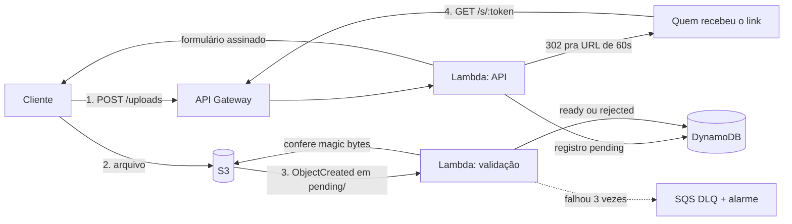

# Starfile

[](https://github.com/matheusoliveira3631/starfile/actions/workflows/ci.yml)

Compartilhamento de arquivos com links temporários. Os arquivos vão direto do cliente pro S3, a API roda em Lambda e os metadados ficam no DynamoDB.



> A versão antiga, em Flask, está na tag [`v1-flask`](https://github.com/matheusoliveira3631/starfile/tree/v1-flask).

## Como funciona o upload

O arquivo nunca passa pela API. O cliente pede uma URL, manda o arquivo direto pro S3 e uma Lambda confere o conteúdo depois.

1. `POST /uploads` com `{ filename, contentType, size }`. A API checa tamanho, tipo e extensão, grava o registro como `pending` e devolve um formulário de presigned POST.
2. O cliente envia o arquivo para o S3 com esse formulário. A policy amarra key, `Content-Type` e tamanho exato (`content-length-range`), então o S3 recusa qualquer coisa diferente do que foi declarado.
3. O evento do S3 dispara a Lambda de validação, que lê os primeiros bytes e compara a assinatura real do arquivo com o tipo declarado. Se bater, o arquivo vai de `pending/` para `files/` e o registro vira `ready`. Se não, o arquivo é apagado e o registro vira `rejected`.
4. `GET /files/:id` mostra o status.

Tipos aceitos: PNG, JPEG, GIF, WebP, PDF, ZIP e texto (UTF-8). Limite padrão de 25 MB (`MAX_UPLOAD_MB`).

## Autenticação

As rotas de upload e de gerenciar links pedem uma API key no header `Authorization: Bearer sf_...`. O link público (`/s/:token`) e o `/health` não pedem.

```bash
npm run api-key -- create alice "notebook"   # mostra a chave uma vez só
npm run api-key -- revoke sf_...
```

- A chave tem 256 bits aleatórios. No banco fica só o SHA-256. Pra senha seria argon2, porque senha tem pouca entropia e cai em dicionário. Pra uma chave aleatória desse tamanho não existe dicionário, e um hash lento só gastaria CPU em toda requisição.
- O prefixo `sf_` deixa fácil achar a chave com secret scanning se alguém commitar sem querer.
- Cada arquivo tem um dono. Arquivo de outra pessoa responde 404, igual a um que não existe, pra não confirmar que o id é válido.
- Chave revogada para de funcionar na requisição seguinte: a busca é uma leitura consistente na tabela principal.

Por que API key e não login com senha: é uma API pra ser usada por script e CLI, não por um formulário de login. Com chave não tem senha pra guardar, nem fluxo de recuperação ou refresh token. Se um dia tiver um front, o caminho é o Cognito emitir o token, não a API guardar senha.

## Rate limit

| Regra | Limite padrão | Por |
| --- | --- | --- |
| Rotas autenticadas | 300 por minuto | dono da chave |
| `POST /uploads` | 50 por hora | dono da chave |
| `GET /s/:token` | 60 por minuto | IP |
| Falha de autenticação | 20 por minuto | IP |

As respostas trazem `RateLimit-Limit`, `RateLimit-Remaining` e `RateLimit-Reset`, e o 429 traz `Retry-After`.

O contador fica no DynamoDB, não em memória. Na Lambda cada instância tem a sua memória, então um limite em memória vira um limite por instância: com 50 instâncias quentes, o limite real seria 50 vezes maior. É janela fixa: um item por janela, incrementado de forma atômica e apagado pelo TTL. A desvantagem conhecida é que alguém pode gastar o limite no fim de uma janela e de novo no começo da próxima. Pra esse uso tudo bem. O API Gateway também tem throttling próprio, que entra na infra como primeira barreira.

O IP usado nos limites, na Lambda, é o `sourceIp` que o próprio API Gateway informa, e o cliente não tem como forjar. `TRUST_PROXY=true` só serve se o servidor rodar atrás de um load balancer ou proxy reverso, quando o IP real vem no `X-Forwarded-For`. Fora desse caso, deixe `false`, senão qualquer um troca de IP mandando esse header.

## Links de compartilhamento

Arquivo pronto ganha links com validade e, se quiser, limite de downloads.

| Rota | O que faz |
| --- | --- |
| `POST /files/:id/links` | cria um link. Corpo opcional: `{ expiresInHours, maxDownloads }` (padrão 24h, sem limite) |
| `GET /files/:id/links` | lista os links do arquivo, com downloads e se ainda está ativo |
| `DELETE /files/:id/links/:linkId` | revoga o link na hora |
| `GET /s/:token` | o link público: conta o download e redireciona pro S3 |

Por que o link é um token próprio e não uma URL assinada do S3 direto:

- **Validade.** URL assinada dura no máximo 7 dias e, assinada com credencial temporária (o caso de uma Lambda), morre quando a sessão expira, às vezes em poucas horas.
- **Revogação e limite.** Uma URL assinada não tem como ser cancelada nem contar acessos. O token passa pela API, então dá.
- **Vazamento.** O redirect vai pra uma URL do S3 que vale 60 segundos (`DOWNLOAD_URL_TTL_SECONDS`). Se ela aparecer num log ou no histórico do navegador, já morreu.

Outros detalhes:

- No banco fica só o SHA-256 do token. Quem tiver acesso à tabela não consegue montar nenhum link.
- A checagem de validade e limite e o incremento do contador são uma única escrita condicional no DynamoDB. Com limite de 1 download e 20 requisições simultâneas, passa exatamente uma.
- O link nunca dura mais que o arquivo, que fica guardado por `FILE_RETENTION_DAYS` (padrão 30). O TTL do DynamoDB pode levar até dois dias pra apagar um item vencido, então a API confere a data em toda leitura e não depende dele.
- O download sai sempre como `attachment`, então o navegador baixa em vez de abrir o arquivo.

## Infraestrutura

Tudo em CDK (`infra/`), numa stack só:

- **S3** privado, com acesso público bloqueado, HTTPS obrigatório e criptografia. Lifecycle apaga `pending/` em 1 dia e `files/` depois da retenção.
- **DynamoDB** em uma tabela, sob demanda, com TTL, índice por hash do token e point-in-time recovery.
- **Duas Lambdas** em Node 22 ARM: a API (Fastify via `@fastify/aws-lambda`) e a validação, disparada pelo S3. Se a validação falhar 3 vezes, o evento vai pra uma fila SQS com alarme.
- **API Gateway HTTP** com throttling (50 req/s, pico de 100) e log de acesso sem header nenhum.

As permissões são escritas à mão, sem `grantReadWrite`. A API só pode gravar em `pending/` e ler de `files/`, e não apaga nada. A validação só lê e apaga em `pending/` e grava em `files/`. Ela também tem `s3:ListBucket`, porque sem ele o S3 responde 403 em vez de 404 pra um objeto que não existe, e um evento repetido viraria erro de permissão.

O SDK da AWS vai dentro do bundle. O CDK por padrão deixa ele de fora, contando com o do runtime, mas o runtime não traz todos os pacotes e muda de versão sem aviso.

```bash
npx cdk bootstrap                        # uma vez por conta/região
npx cdk deploy -c stage=dev
npx cdk deploy -c stage=prod -c alarmEmail=voce@exemplo.com
npm run api-key -- create voce "notebook" # com BUCKET_NAME e TABLE_NAME dos outputs
```

Contexto aceito: `stage` (fora de `prod`, bucket e tabela são apagados junto com a stack), `allowedOrigins` (lista separada por vírgula, liga o CORS pra upload pelo navegador), `fileRetentionDays` e `alarmEmail`.

## CI e deploy

Em todo PR e em todo push na `master`, o [CI](.github/workflows/ci.yml) roda lint, typecheck, testes de unidade, `npm audit` e `cdk synth`, que já gera os bundles das Lambdas. Num job separado roda os testes de integração contra o LocalStack, com a checagem de assinatura do S3 ligada. Sem ela, o LocalStack aceita URL vencida ou adulterada e os testes de expiração passam sem provar nada.

Quando o CI passa na `master`, o [deploy](.github/workflows/deploy.yml) faz `cdk deploy` em produção sem nenhuma chave da AWS guardada no GitHub. O job pede um token OIDC ao GitHub e troca por credenciais temporárias de um papel IAM, que só aceita tokens deste repositório no environment `production`. O papel não mexe em recurso nenhum diretamente, só assume os papéis criados pelo `cdk bootstrap`.

As actions são fixadas por SHA do commit, não por tag. Tag pode ser movida pra apontar pra outro código; commit não. O Dependabot abre PR semanal pra atualizar actions e dependências.

Pra ligar o deploy (uma vez só):

```bash
npx cdk bootstrap
npx cdk deploy StarfileGithubOidc     # cria o provedor OIDC e o papel; anote o DeployRoleArn
```

No GitHub: crie o environment `production` (Settings → Environments, de preferência exigindo aprovação) e, em Settings → Variables, a variável `AWS_DEPLOY_ROLE_ARN` com o ARN do papel. `AWS_REGION` e `ALARM_EMAIL` são opcionais. Enquanto `AWS_DEPLOY_ROLE_ARN` não existir, o deploy é pulado.

## Rodando localmente

Precisa de Node 22 e Docker (pro LocalStack, que emula S3 e DynamoDB).

```bash
npm install
cp .env.example .env
docker compose up -d
npm run dev                # http://localhost:3000/health
npm run test:integration   # testes contra o LocalStack
```

## Scripts

| Comando | O que faz |
| --- | --- |
| `npm run dev` | servidor local com reload |
| `npm test` | testes de unidade |
| `npm run test:integration` | testes contra o LocalStack (`docker compose up -d` antes) |
| `npm run lint` | ESLint |
| `npm run typecheck` | checagem de tipos |
| `npm run build` | compila para `dist/` |
| `npm run synth` | gera o template do CloudFormation |
| `npm run api-key` | cria e revoga API keys |
